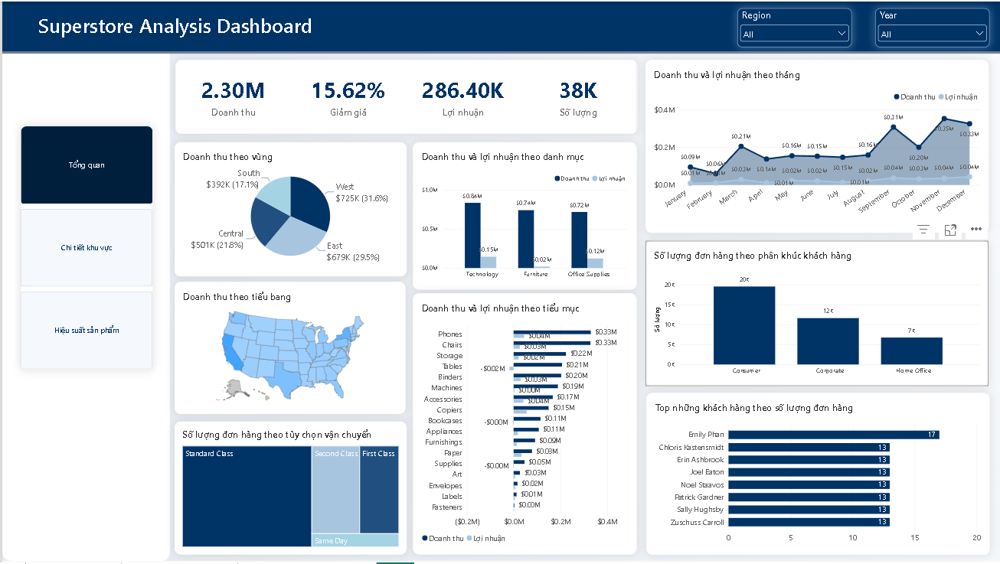
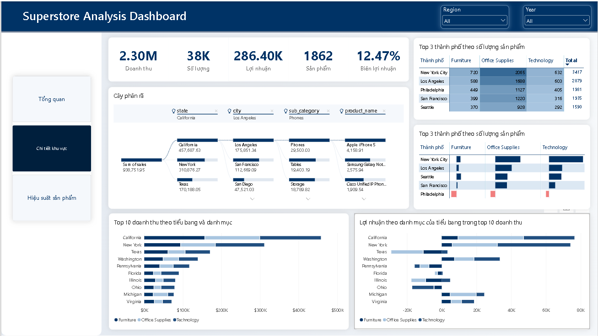

# Superstore Sales & Profitability Analysis

## 📌 Project Overview

This project analyzes retail sales data to evaluate business performance, identify profitability issues, and generate actionable recommendations.

The analysis focuses on sales trends, customer segments, regional performance, and product profitability to support data-driven business decisions.

## 🎯 Business Objectives

- Evaluate overall sales and profitability.
- Identify customer segments with strong sales performance.
- Analyze regional differences in sales and profit.
- Identify products with high sales but low or negative profit.
- Recommend strategies to improve profitability.

## 📊 Dataset

- **Source:** https://www.kaggle.com/datasets/vivek468/superstore-dataset-final/data
- **Dataset:** Superstore Sales Dataset
- **Key attributes:** Order Date, Sales, Profit, Discount, Category, Region, Customer Segment.
- **Data preparation:** Missing values, duplicate records, and inconsistent categories were reviewed and handled where appropriate.

## 🛠️ Tools & Technologies

- **Python:** Data cleaning and preprocessing
- **Pandas:** Data manipulation and transformation
- **SQL:** Data querying and analysis
- **Power BI:** Data visualization and dashboard development

## ⚙️ Methodology

1. **Data Understanding:** Inspected the dataset structure, data types, and data quality.
2. **Data Cleaning:** Handled missing values, duplicate records, and inconsistent categorical values.
3. **Exploratory Data Analysis:** Examined sales, profit, discounts, customer segments, and regional performance.
4. **Data Visualization:** Built charts and dashboards to communicate key findings.
5. **Business Recommendations:** Translated analytical findings into potential business actions.

## 🔍 Key Insights

### 1. Overview Analysis
Some products generated high sales but low or negative profit, indicating that revenue alone does not reflect business performance.

### 2. Regional Performance
Profitability varied across regions, suggesting opportunities to investigate differences in pricing, discount policies, and operating costs.

### 3. Product Performance
Certain products within the Furniture category, particularly Tables and Bookcases, showed profitability concerns and may require further investigation.


## 💡 Recommendations

- Review discount policies for products with negative profit.
- Investigate pricing and cost structures for underperforming products.
- Analyze regional differences to identify potential operational improvements.
- Focus marketing and retention strategies on valuable customer segments.

## 📈 Dashboard Preview

## SALE OVERVIEW


## REGIONAL ANALYSIS


## PRODUCT PERFORMANCE


## 📂 Project Structure

```text
SuperStoreSalesAnalysis/
├── Datasets/
│   └── Superstore Dataset.csv
│   └── Superstore Dataset Cleaned.csv
├── images/
│   └── dashboard.png
├── datacleaning.ipynb
├── (machinelearning).ipynb
└── README.md
```
## 👤 Author

**Dat Doan**

- GitHub: [@ETTE2104](https://github.com/ETTE2104)
- LinkedIn: [Dat Doan](https://www.linkedin.com/in/dat-doan-8b6987358/)

## 🙏 Acknowledgements & References

- **[WuCandice]** — [Original Project](https://github.com/WuCandice/Superstore-Sales-Analysis)

## 📄 License

This project is intended for educational and portfolio purposes.
